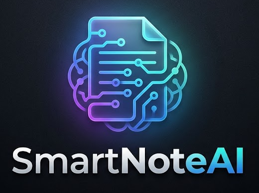

<p align="center">
  
</p>

# SmartNoteAI 🎓✨

[](https://github.com/sgr-m/SmartNoteAI/releases)
[](https://github.com/sgr-m/SmartNoteAI/releases)
[](https://github.com/sgr-m/SmartNoteAI)
[](LICENSE)
[](CONTRIBUTING.md)

**SmartNoteAI** is a high-performance, open-source interactive digital whiteboard and teaching software engineered for Windows 10 & 11. Designed specifically for educators, STEM instructors, remote tutors, and content creators, SmartNoteAI delivers low-latency canvas drawing, deep hardware graphics tablet & stylus digitizer integration, live desktop overlay annotation, intelligent geometric shape recognition, and native offline LaTeX formula rendering.

---

## 🎯 Project Purpose: Problems It Solves

Traditional digital whiteboard tools often suffer from significant latency, require persistent high-speed internet connections, or force educators into rigid subscription-based cloud ecosystems. 

**SmartNoteAI solves these challenges by:**
1. **Operating 100% Offline**: All core capabilities—including vector drawing, LaTeX equation rendering, PDF importing, and resource management—run locally on your PC without mandatory cloud accounts.
2. **First-Class Hardware Stylus Support**: Native integration with precision digitizers (XP-Pen, Wacom, Huion) with real-time pressure dynamics and touch palm rejection.
3. **Seamless Screen Annotation**: Educators can instantly toggle to **Desktop Mode** to annotate directly over live code (VS Code), presentations, browser simulations, or video lessons without interrupting the classroom flow.
4. **STEM-Optimized Teaching Tools**: Integrated mathematical rulers, 180° protractors, coordinate axes, and KaTeX equation formatting tailored for mathematics, physics, and computer science teaching.

---

## 🖼️ Application Screenshots

### 1. Interactive Whiteboard with Math Teaching Notes

*Live classroom lecture with handwritten notes, quadratic formulas, vector diagrams, and bottom floating dock.*

---

### 2. STEM Lecture: Computer Science & LaTeX Equation Editor

*Digital electronics truth table, logic circuit diagram, and built-in LaTeX formula editor.*

---

### 3. Subject Teaching Tools (Math Ruler, Protractor & Triangle)

*Interactive 180° protractor, 30 cm metric ruler, and geometric drawing instruments.*

---

### 4. Presentation Focus & Spotlight Tool

*Spotlight overlay dimming background distractions to direct student focus to specific board sections.*

---

### 5. Teaching Resource Library & Asset Management

*Integrated library for managing and inserting custom diagrams, shapes, and teaching templates.*

---

## 🚀 Key Features

- **🖊️ Precision Stylus & Digitizer Engine**:
  - Full support for **XP-Pen Deco Mini 7**, Deco Series, **Wacom One / Intuos**, **Huion**, and Windows Ink digitizers via `DirectManipulationStylus`.
  - Continuous pressure sensitivity adapting stroke widths smoothly without lag.
  - Hardware palm rejection ignoring unintentional multi-touch contact.
  - Dual mouse and pen coordination preventing cursor lock or dropped strokes.

- **🖥️ Live Desktop Annotation & Area Snip**:
  - Compact floating toolbar to draw notes directly over external Windows applications.
  - Area screen-snip tool to capture any desktop window or rectangular area and paste it directly onto the active canvas.

- **📺 True Fullscreen Presentation Mode**:
  - Seamless single-click full screen with synchronized window bounds and zero desktop flicker.
  - Ergonomic bottom dock with quick flyouts for pens, colors, highlighters, erasers, and slides.

- **📐 Intelligent Geometric Recognition**:
  - Automatically identifies hand-drawn rough shapes (straight lines, triangles, polygons, circles, ellipses, rectangles) and converts them into crisp vector figures.

- **🧮 Mathematical & Scientific Typography (LaTeX / KaTeX)**:
  - Built-in LaTeX editor rendering mathematical expressions locally with bundled vector fonts.

- **📑 Document Import & Export**:
  - PDF textbook and assignment import onto canvas pages.
  - Multi-page lesson export to printable **PDF**, high-resolution **PNG**, or vector **SVG**.
  - Versioned native editable lesson file format (`.sbl`).

---

## 💻 System Requirements

| Specification | Minimum | Recommended |
| :--- | :--- | :--- |
| **Operating System** | Windows 10 (64-bit, 1809+) | Windows 10 / Windows 11 (64-bit) |
| **Processor** | Intel Core i3 / AMD Ryzen 3 or equivalent | Intel Core i5 / AMD Ryzen 5 or faster |
| **Memory (RAM)** | 4 GB RAM | 8 GB RAM or higher |
| **Storage** | 350 MB available space | 1 GB available space (for lesson storage) |
| **Input Devices** | Mouse / Touchpad | Graphics Tablet (XP-Pen, Wacom, Huion) or Touchscreen Stylus |

---

## 📥 Official Windows Download & Installation

### Official Download
Always download official, virus-scanned releases from the project's original repository:
👉 [**Download Latest Windows Release (GitHub Releases)**](https://github.com/sgr-m/SmartNoteAI/releases)

- **Installer File**: `SmartNoteAI.Setup.0.1.0.exe` (~102 MB)
- **SHA-256 Checksum**: `9F51BABB3F2D6D255E0A5BCC60FD207C4669D0584E30F5CA403C7E2546607139`

### Installation Steps
1. Download `SmartNoteAI.Setup.0.1.0.exe` from the [Releases page](https://github.com/sgr-m/SmartNoteAI/releases).
2. Double-click the downloaded executable to start the setup wizard.
3. Select your installation folder and choose whether to create a Desktop shortcut.
4. Click **Install**. Once finished, launch **SmartNoteAI** from the Start Menu or Desktop.

---

## ⚠️ Troubleshooting & Known Limitations

### Windows Defender SmartScreen ("Windows protected your PC")
- **Cause**: SmartNoteAI is a newly released open-source project and is not yet signed with an expensive commercial Extended Validation (EV) certificate.
- **Solution**: Click **"More info"** on the blue SmartScreen popup, then click **"Run anyway"**. The installer and code are completely open-source, and you can verify the SHA-256 checksum against the official release.

### Stylus Pressure Sensitivity Not Detected
- Open your tablet driver software (XP-Pen Pentablet, Wacom Desktop Center, or Huion Tablet).
- Ensure that **Windows Ink** is checked/enabled in your tablet settings.
- If using dual monitors, verify the tablet screen mapping in your tablet control panel.

---

## ⌨️ Keyboard Shortcuts

| Shortcut | Action |
| :--- | :--- |
| `P` | Pen tool |
| `E` | Eraser tool |
| `S` | Select / Move tool |
| `H` | Shape & Recognition tool |
| `T` | Text tool |
| `Space` + Drag | Pan across infinite canvas |
| `Ctrl` + `Z` | Undo |
| `Ctrl` + `Y` / `Ctrl` + `Shift` + `Z` | Redo |
| `Ctrl` + `+` / `Ctrl` + `-` | Zoom In / Out |
| `Ctrl` + `0` | Reset / Fit Page |
| `F11` | Toggle Fullscreen Presentation Mode |
| `D` | Toggle Desktop Annotation Mode |

---

## 🛠️ Building from Source

### Prerequisites
- [Node.js](https://nodejs.org/) (v18.x or v20.x recommended)
- [npm](https://www.npmjs.com/) (v9 or higher)
- Windows 10 or 11 (64-bit)
- Git

### Build Instructions
```bash
# 1. Clone the repository
git clone https://github.com/sgr-m/SmartNoteAI.git
cd SmartNoteAI/smartboard-studio

# 2. Install dependencies
npm install

# 3. Start development server
npm run dev

# 4. Run automated test suite
npm test

# 5. Build production Windows installer
npm run dist
```
The packaged NSIS installer will be located in `release/SmartNoteAI Setup 0.1.0.exe`.

---

## 💖 Voluntary Donations (UPI & PayPal)

If you find this software useful, you can optionally support its continued development through UPI or PayPal. Donations are voluntary and are not required to use the software. Your support helps fund maintenance, bug fixes, and future improvements.

### 🇮🇳 UPI (India)
- **UPI ID**: `YOUR_UPI_ID_HERE`
- **Supported Apps**: Google Pay, PhonePe, Paytm, BHIM, CRED

### 🌐 PayPal (International)
- **PayPal Link**: [`YOUR_PAYPAL_DONATION_URL_HERE`](YOUR_PAYPAL_DONATION_URL_HERE)

*(See [DONATE.md](DONATE.md) for further information regarding voluntary support.)*

---

## 🌐 Official Links

- **Official Repository**: [https://github.com/sgr-m/SmartNoteAI](https://github.com/sgr-m/SmartNoteAI)
- **Official Website**: `https://sgr-m.github.io/SmartNoteAI/` *(Coming Soon)*
- **Issue Tracker**: [https://github.com/sgr-m/SmartNoteAI/issues](https://github.com/sgr-m/SmartNoteAI/issues)
- **Contributing**: [CONTRIBUTING.md](CONTRIBUTING.md)
- **Code of Conduct**: [CODE_OF_CONDUCT.md](CODE_OF_CONDUCT.md)
- **Security Policy**: [SECURITY.md](SECURITY.md)
- **Trademark Policy**: [TRADEMARKS.md](TRADEMARKS.md)

---

## 📄 License & Intellectual Property

This project is open-source software licensed under the [MIT License](LICENSE).  
Copyright (c) 2026 Sagar Maindola.

Third-party libraries, fonts, and dependencies retain their respective licenses:
- KaTeX (MIT) & KaTeX Fonts (SIL OFL 1.1)
- PDF.js (Apache License 2.0)
- jsPDF (MIT License)
- React & Electron (MIT License)

See [TRADEMARKS.md](TRADEMARKS.md) for information regarding project branding, name, and logo guidelines.
