<p align="center">
  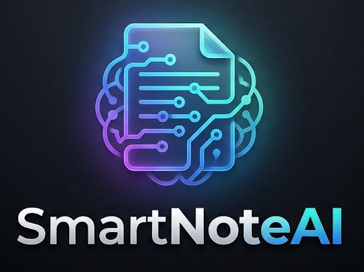
</p>

# SmartNoteAI 🎓✨

[](https://sgr-m.github.io/SmartNoteAI/)
[](https://github.com/sgr-m/SmartNoteAI/releases)
[](https://github.com/sgr-m/SmartNoteAI/releases)
[](https://github.com/sgr-m/SmartNoteAI)
[](LICENSE)
[](CONTRIBUTING.md)

**SmartNoteAI** is a high-performance, open-source interactive digital whiteboard, AI teaching assistant, and STEM/Geography classroom platform engineered for Windows 10 & 11. Built for educators, STEM instructors, geography teachers, remote tutors, and content creators, SmartNoteAI combines ultra-low-latency hardware stylus inking and 100% offline KaTeX/PDF teaching tools with AI lesson & diagram generation, drag-and-drop board insertion, one-click slide enhancement, an integrated multi-tab educational web browser, and an authoritative Survey of India Geography Resource Centre.

> 🌐 **Official SmartNoteAI Website**: Visit [https://sgr-m.github.io/SmartNoteAI/](https://sgr-m.github.io/SmartNoteAI/) for interactive feature demos, live video walkthrough, gallery, documentation, and verified installer downloads.

---

## 🎯 Project Purpose: Problems It Solves

Traditional digital whiteboard tools often suffer from sluggish inking, subscription locks, missing curriculum instruments, or rigid ecosystems disconnected from classroom workflows.

**SmartNoteAI solves these challenges by:**
1. **Offline-First Teaching Core (with Flexible AI)**: All core classroom capabilities—vector drawing, hardware stylus inking, KaTeX equation rendering, PDF import/export, Subject STEM tools, and cached Survey of India maps—run locally on your Windows PC, while optional AI integrates both cloud models (Google Gemini, OpenAI, DeepSeek, Groq, Kimi) and 100% offline **Ollama** local LLMs.
2. **First-Class Hardware Stylus Support**: Native integration with precision digitizers (XP-Pen, Wacom, Huion) with continuous pressure sensitivity and multi-touch palm rejection.
3. **AI Co-Teacher Directly Inside the Whiteboard**: Generate full structured notes, LaTeX proofs, comparison tables, practice quizzes, Mermaid flowcharts, and multi-slide decks—then **drag & drop** individual cards onto the canvas or click **✨ Enhance** / **✨ Ask AI** on board objects.
4. **Integrated Subject Platforms, Web Browser & Geography Atlas**: Teach across Mathematics, Physics, Chemistry, Computer Science, Digital Logic, Flowcharts, and Geography (with official **Survey of India** 1:50,000 Toposheets, India 28 States & 8 UTs maps, World maps, and an Interactive 3D Earth & Globe Lab), or capture diagrams directly from PhET/Wikipedia using the built-in multi-tab browser.

---

## ✨ New in v2.1.0: AI Teaching Assistant, Integrated Browser & Resource Platforms

### 1. 🤖 AI Teaching Assistant, AI Generation, Drag & Drop, AI Enhance & Ask AI
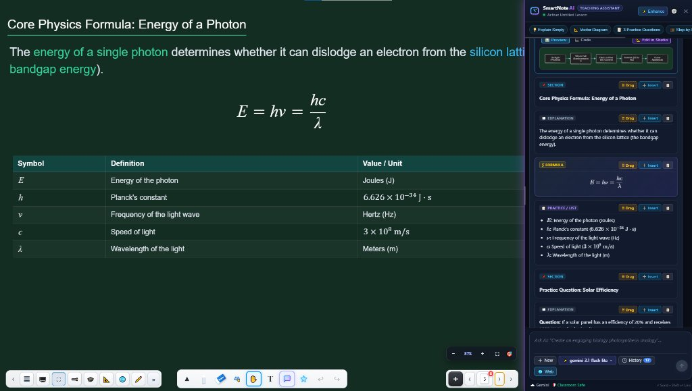
*AI Teaching Assistant docked alongside the whiteboard: generating Vector Diagrams, Section Headers, Explanations, KaTeX Formulas ($E = h\nu = hc/\lambda$), Symbol Tables, Practice Lists, and Web Search results ready for Drag & Drop or 1-Click Insert.*

- **Multi-Provider AI Generation**: Connect **Google Gemini** (`gemini-2.5-flash`, `gemini-2.5-flash-lite`, etc.), **Ollama** (100% local offline models auto-detected on your PC), **DeepSeek**, **Groq Cloud**, **Kimi (Moonshot AI)**, **OpenAI**, or any OpenAI-compatible custom endpoint—with one-click quick prompts (`Explain Simply`, `Vector Diagram`, `3 Practice Questions`, `Step-by-Step Math`, `Real-World Analogy`, `Comparison Table`).
- **Smart Modular Cards — Drag & Drop + 1-Click Insert**: Every AI response is automatically segmented into typed cards (`SECTION`, `EXPLANATION`, `FORMULA`, `PRACTICE / LIST`, `VECTOR DIAGRAM`, and `Web Images`) with **Drag** handles (drop directly onto any exact canvas location) and **+ Insert** buttons.
- **1-Click ✨ AI Enhance (Full Slide & Textbox)**:
  - **Slide-Wide Enhance**: Intelligently restructures headings, formulas, tables, callout boxes, theme colors, borders, and non-overlapping layout across the entire board with step-by-step live feedback and full `Ctrl+Z` undo.
  - **Individual Textbox Enhance**: Select any canvas textbox and click **✨ Enhance** to upgrade formatting, KaTeX inline math, and visual card styling.
- **Contextual ✨ Ask AI on Board Objects**: Select any textbox on your whiteboard and click **✨ Ask AI** right above it to send that text straight into the AI Teaching Assistant to solve, simplify, verify, or elaborate live in class.
- **AI Vector Diagram Studio**: Preview, edit code, or launch the **Vector Diagram Studio** supporting **Mermaid.js** flowcharts, **Function Graphs**, **2D Geometry (JSXGraph)**, **Digital Logic Circuits (CircuitikZ)**, **Timing Waveforms (WaveDrom)**, and **TikZ** vector paths.
- **Web AI Search & Live Image Discovery**: Toggle **Web** mode in chat to ground answers with live web sources and browse relevant **Web Images** cards for direct drag-and-drop insertion onto the canvas.
- **Full AI Presentation Generator & Slide AI Toolbar**: Turn a topic into a multi-slide deck with auto-subject detection, outline refinement chat, visual themes, and contextual slide actions (`Simplify`, `Expand`, `Improve Grammar`, `Add Example`, `Generate Knowledge Check`, `Identify Misconceptions`, `Reduce Content Density`).

---

### 2. 🌐 Integrated Multi-Tab Educational Web Browser
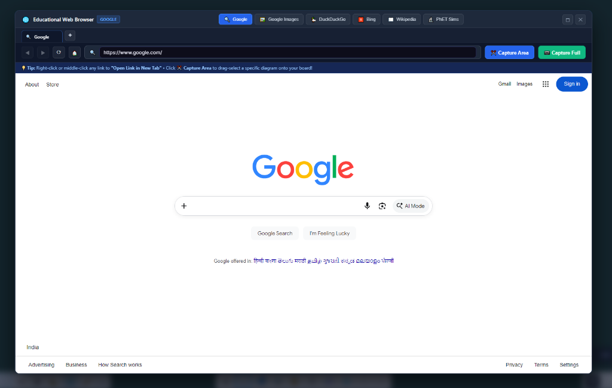
*Built-in Educational Web Browser featuring 1-click learning portals, multi-tab workspace, and area/full-page capture directly onto your whiteboard.*

- **Multi-Tab Classroom Browsing**: Open reference sites cleanly inside SmartNoteAI with `+` tab creation and right-click / middle-click **Open Link in New Tab** without leaving fullscreen teaching mode.
- **One-Click Search & STEM Portals**: Instant toolbar shortcuts for **Google**, **Google Images**, **DuckDuckGo**, **Bing**, **Wikipedia**, and interactive **PhET Simulations**.
- **Capture Area & Capture Full**:
  - **Capture Area**: Drag-select any specific diagram, graph, map, or equation on the webpage and paste it straight onto your active whiteboard slide.
  - **Capture Full**: Snap the entire visible educational page directly onto the canvas as an annotatable layer.

---

### 3. 🎓 Subject Teaching Platform (Multi-Disciplinary Classroom Modules)
Switch seamlessly across subject tabs inside the **Subject Teaching Platform** to insert calibrated vector instruments, interactive simulators, circuits, code blocks, chemical apparatus, logic gates, and geographical maps:

| Subject Module | Interactive Modules, Instruments & Diagrams Included |
| :--- | :--- |
| **📐 Mathematics** | Scientific Calculator, Calibrated Ruler (`cm / mm`), `180°` Protractor, Geometric Compass, `45°` & `30°–60°` Set Squares, Angle Construction, Cartesian Coordinate Axes (`X-Y`), 3D Coordinate Plane (`X-Y-Z`), Function Plotter, Calibrated Number Line, 3D Solids (Cube, Pyramid, Cylinder, Sphere, Cone), Formula & Equation Editor, Analytic Geometry Board, Trigonometry & Unit Circle |
| **⚡ Physics** | Battery / DC Power Supply, Fixed Resistor, Rheostat (Variable Resistor), Capacitor, Inductor / Choke Coil, Knife Switch, Incandescent Lamp / Bulb, Ammeter / Voltmeter Meters, Editable Series & Parallel Circuit Diagrams, Force Vector, Resultant Force Demonstration, Free Body Diagram (FBD), Kinematic Motion Diagram |
| **💻 Computer Science** | Syntax-Highlighted Code Block (Python, JS, C++, Java, SQL), Standardized Pseudocode, Flowchart Builder, Algorithm Trace Table, Call Stack Diagram, Memory Layout & Pointers, Linked List Diagram, Binary Search Tree & Graph, Sorting / Searching Visualizer, Database Table & ER Diagram, CPU & Von Neumann Architecture, Instruction Cycle (`F-D-E`), Network Topology Diagram |
| **🧪 Chemistry** | Interactive Periodic Table, Element Info Card (Bohr / Properties), Bohr Atomic Model, Chemical Equation Balancer, Lab Apparatus (Laboratory Beaker, Erlenmeyer Flask, Bunsen Burner, Test Tube Rack), Hydrocarbon Combustion Workspace, Acid-Base Titration Setup |
| **🔌 Digital Logic & Flowcharts** | 7 IEEE Logic Gates (`AND`, `OR`, `NOT`, `NAND`, `NOR`, `XOR`, `XNOR`), Truth Table Generator, Karnaugh Map (`K-Map`), Multiplexer (`N:1 MUX`), Arithmetic Adders (Half / Full), Flip-Flops (`D`, `JK`, `SR`, `T`), 4-Bit Binary Counter, Half Adder Circuit Architecture, ISO Flowchart Blocks (Terminator, Process, Decision, I/O, Subroutine, Loop) |
| **🌍 Geography** | Geography Resource Centre launcher, Official Survey of India Map, Interactive Topographical Map Viewer (`1:50,000` SoI), Conventional Signs & Symbols Panel, Interactive 3D Earth & Globe Lab, India Outline Map Worksheets |
| **🧠 Common & General Teaching** | Mind Map, Concept Map, Interactive Timeline, Hierarchy Chart, Process Flow (Chevrons), Venn Diagram, Pros vs. Cons Board, Number Systems Hierarchy, Scientific Method Process Board, Interactive Q&A Card, Classroom Seating Diagram |

#### Subject Teaching Platform Previews
<details open>
<summary><strong>Browse Subject Modules (Mathematics, Physics, Computer Science & Geography)</strong></summary>

| Mathematics | Physics |
| :---: | :---: |
| 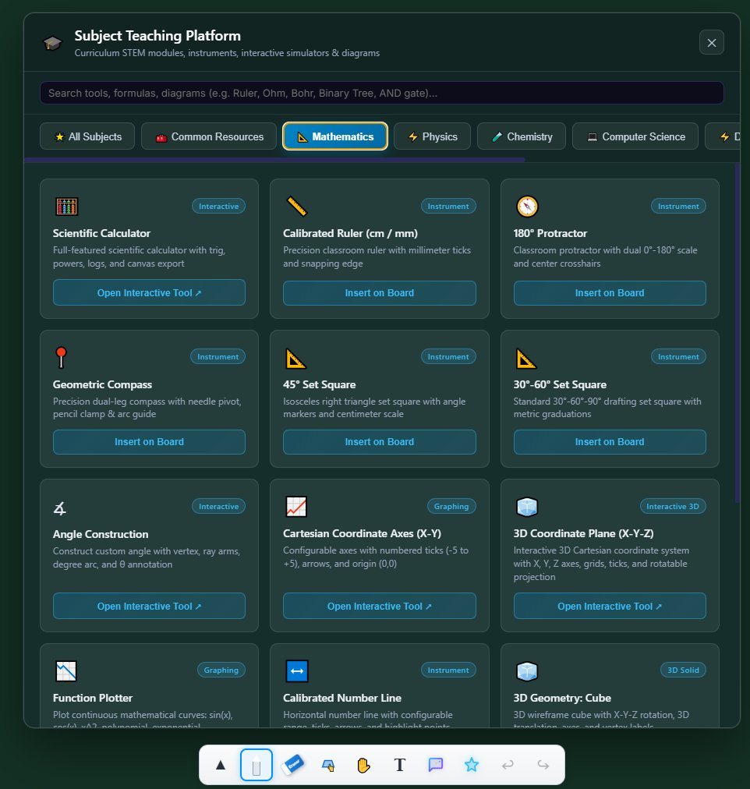 | 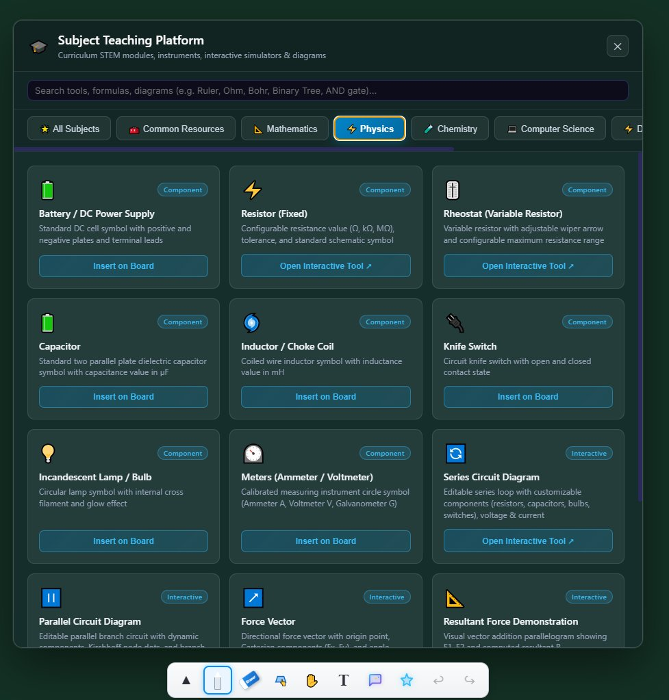 |
| **Computer Science** | **Geography Module** |
| 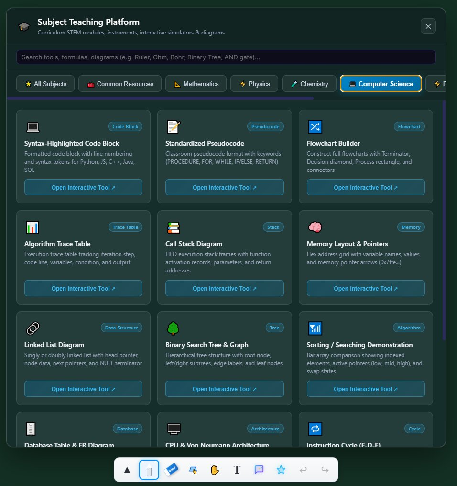 | 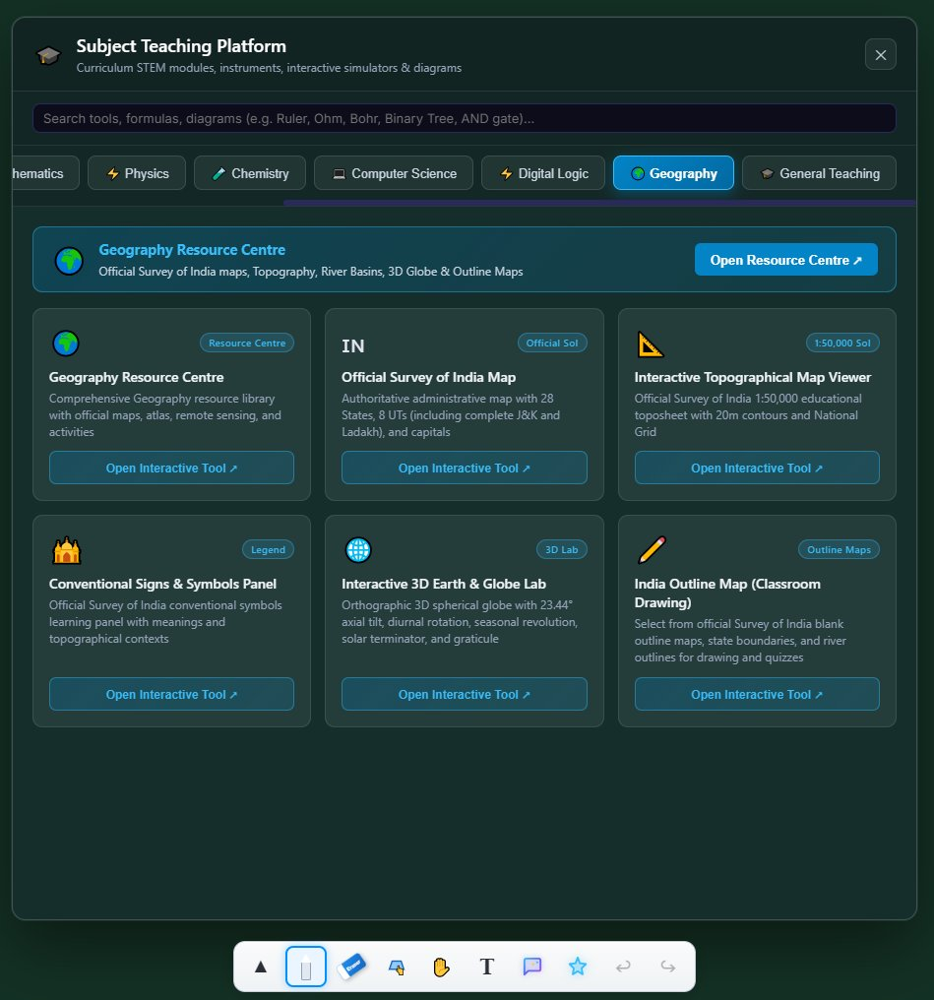 |

</details>

---

### 4. 🌍 Geography Resource Centre (Official Survey of India Standard)
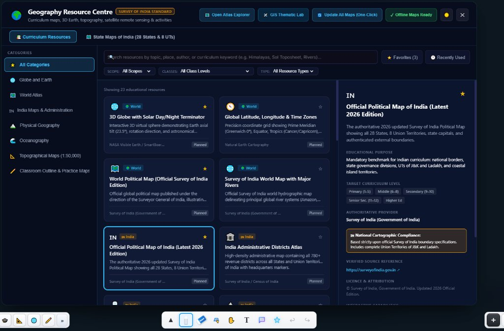
*Geography Resource Centre (`SURVEY OF INDIA STANDARD`): featuring 23 curated resources, 28 States & 8 UTs directory, Atlas Explorer, GIS Thematic Lab, 1:50,000 Open Series Toposheets, 3D Globe Lab, and One-Click Offline Sync.*

Engineered with strict adherence to **[Survey of India](https://surveyofindia.gov.in)** cartographic standards and National Cartographic Compliance:

- **🇮🇳 Official India Maps & Administration**:
  - **Official Political Map of India (Latest 2026 Edition)**: Complete authenticated boundaries showing all **28 States and 8 Union Territories** (including complete Jammu & Kashmir and Ladakh) and capitals.
  - **State Maps of India (28 States & 8 UTs)**: Dedicated tab for searching and inspecting individual Indian states and union territories with official capitals, areas, and verified Survey of India portals.
  - **India Administrative Districts Atlas**: High-density administrative map covering **780+ districts** with headquarters markers.
  - **Physical, Drainage & Railways**: Official Survey of India Physical Map, Physiographic Divisions (GSI), Central Water Commission (CWC) Drainage & River Basins, and Official Indian Railways Network (23rd Edn 2026).
- **🗺️ World Atlas & Oceanography**:
  - **World Political Map (Official Survey of India Edition)** and **Survey of India World Map with Major Rivers**.
  - **Oceanography Layer**: Global thermohaline circulation, warm/cold ocean currents, and the 5 great subtropical gyres.
- **📐 Topographical Maps (`1:50,000` Survey of India OSM Series)**:
  - Interactive pan/zoom viewer for official Survey of India Open Series Maps (`45D/7`, `45D/10`, `45F/3`, `53B/7`, `53E/16`, `63K/12`, `64P/13`, `56D/11`) with **20 m contours**.
  - **4-Figure & 6-Figure National Grid Reference** demonstrator, **Scale & Measurement Lab** (`RF 1:50,000`, `2 cm = 1 km`, bearings & area in `km²` / hectares), and interactive **Conventional Signs & Symbols Panel**.
- **🌐 Interactive 3D Earth & Globe Lab**:
  - Orthographic 3D spherical globe (plus unrolled flat projection) demonstrating Earth's **`23.44°` / `23.5°` axial tilt**, diurnal rotation, equinox/solstice presets, live **Solar Day/Night Terminator**, Tropics, Polar Circles, Prime Meridian graticule, and **IST (`82.5° E`)** time zone explorer.

---

## 🖼️ Additional Whiteboard Screenshots

### 1. Interactive Whiteboard: Advanced STEM & Math Derivations
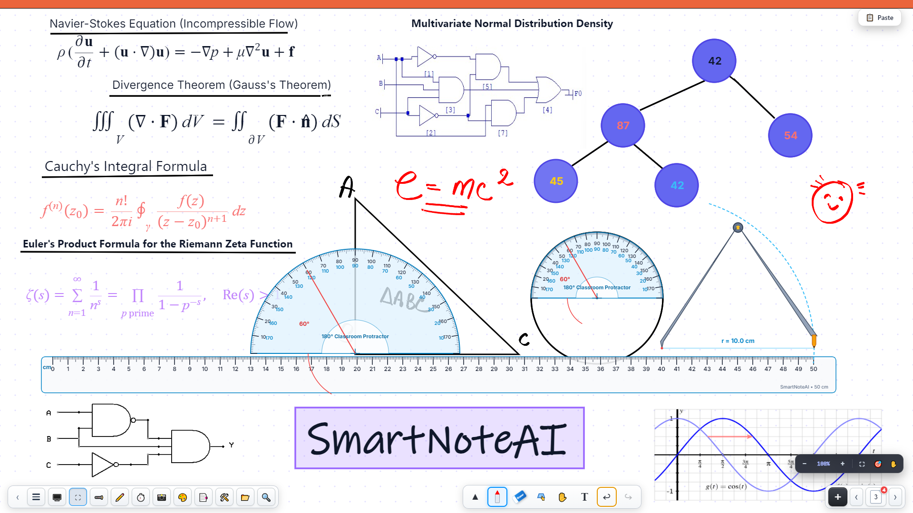
*Live classroom lecture canvas showing Navier-Stokes, Gauss Divergence, Cauchy Integral, and Riemann Zeta formulas, binary search tree, 50 cm metric ruler, 180° protractor, and cosine waveform.*

---

### 2. Live Desktop Annotation: VS Code & Python Jupyter Notebook
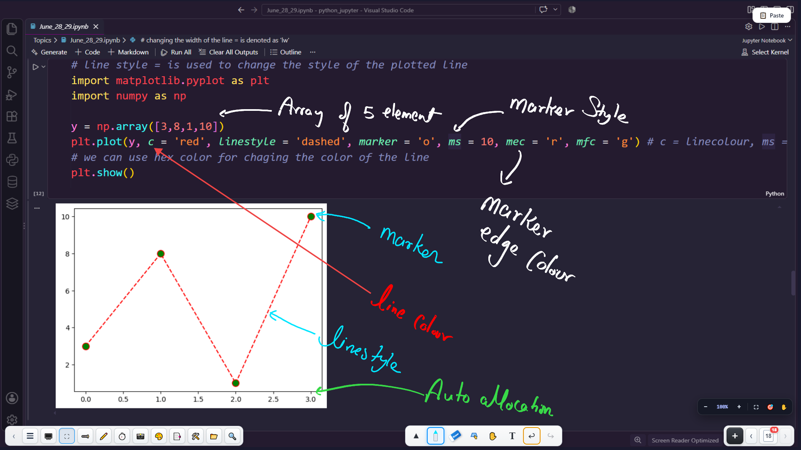
*Annotating directly over Visual Studio Code, Python Jupyter Notebook, and Matplotlib data visualization with handwritten notes, arrows, and the floating bottom dock.*

---

### 3. STEM Subject Instruments 
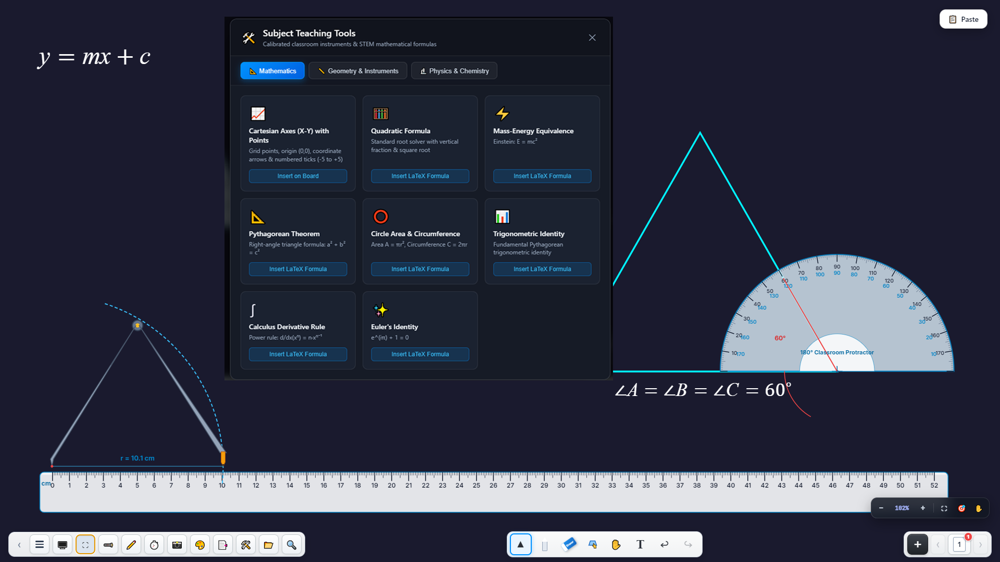
*Active mathematical instruments on canvas including a metric ruler, 180° classroom protractor, and dynamic compass arc.*

---

### 4. Presentation Spotlight & Waveform Timing
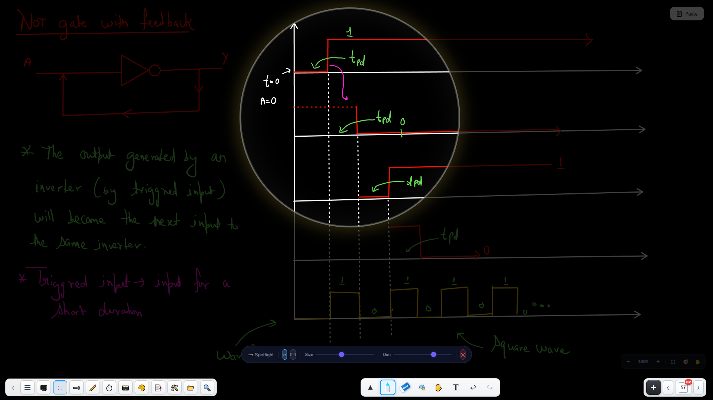
*Circular spotlight beam dimming the background canvas to direct student focus to propagation delay ($t_{pd}$) and square wave pulse transitions.*

---

### 5. STEM Lecture: Logic Circuits & Native KaTeX Formula Editor
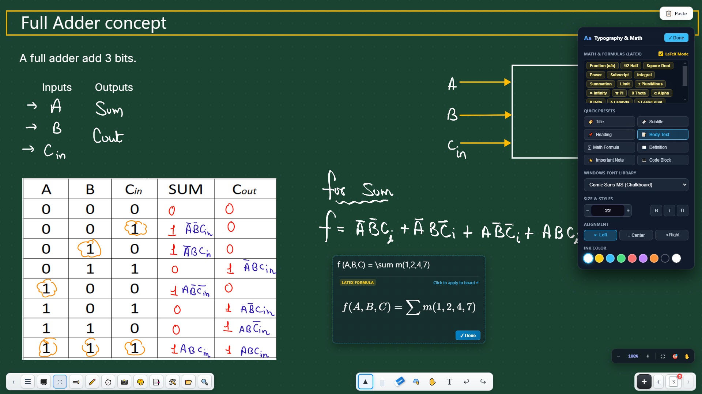
*Digital electronics truth table, Full Adder logic circuit diagram, and built-in offline LaTeX formula editor with vector fonts.*

---

### 6. Subject Teaching Tools & STEM Lesson Modules
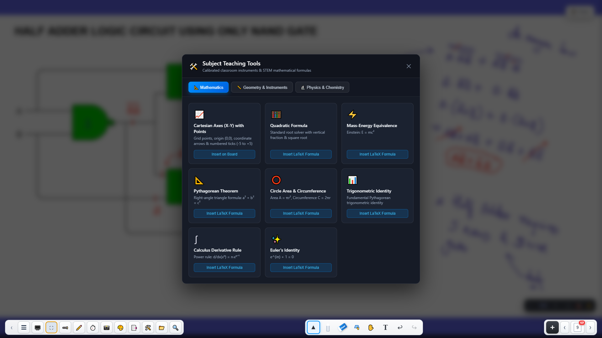
*Calibrated STEM formula modules, Cartesian axes, Pythagorean theorem, and calculus derivative rules ready for one-click board insertion.*


---

## 🚀 Key Features

- **🤖 AI Teaching Studio, Drag & Drop, ✨ Enhance & Ask AI**:
  - Docked AI Teaching Assistant supporting Google Gemini, Ollama (offline local models), DeepSeek, Groq, Kimi, OpenAI, and custom endpoints.
  - Segmented modular response cards (`SECTION`, `EXPLANATION`, `FORMULA`, `PRACTICE / LIST`, `VECTOR DIAGRAM`, `Web Images`) with **Drag & Drop** and **+ Insert**.
  - **1-Click ✨ AI Enhance** on individual textboxes or the full board with zero-overlap reflow, styled tables, and `Ctrl+Z` undo.
  - **Contextual ✨ Ask AI** on board textboxes, **Web AI Search** with grounded web images, **Vector Diagram Studio** (Mermaid, Function Plots, 2D Geometry, Circuits, WaveDrom, TikZ), and full **AI Presentation Generator**.

- **🌐 Integrated Educational Web Browser & 🌍 Geography Resource Centre**:
  - Multi-tab in-app browser with quick shortcuts (`Google`, `Google Images`, `DuckDuckGo`, `Bing`, `Wikipedia`, `PhET Sims`), *"Open Link in New Tab"*, **Capture Area**, and **Capture Full**.
  - Official **Survey of India** Geography Resource Centre featuring the 2026 Political Map (28 States & 8 UTs), 780+ Districts Atlas, 1:50,000 Topographical Open Series Maps, Interactive 3D Earth & Globe Lab, GIS Thematic Lab (`ISRO Bhuvan`), and One-Click Offline Sync.

- **🖊️ Precision Stylus & Digitizer Engine**:
  - Full support for **XP-Pen Deco Mini 7**, Deco Series, **Wacom One / Intuos**, **Huion**, and Windows Ink digitizers via `DirectManipulationStylus`.
  - Continuous pressure sensitivity adapting stroke widths smoothly without lag.
  - Hardware palm rejection ignoring unintentional multi-touch contact.
  - Dual mouse and pen coordination preventing cursor lock or dropped strokes.

- **🖥️ Live Desktop Annotation & Area Snip**:
  - Compact floating toolbar to draw notes directly over external Windows applications.
  - Area screen-snip tool to capture any desktop window or rectangular area and paste it directly onto the active canvas.

- **📺 True Fullscreen Presentation Mode**:
  - Seamless single-click full screen with synchronized window bounds and zero desktop flicker.
  - Ergonomic bottom dock with quick flyouts for pens, colors, highlighters, erasers, and slides.

- **📐 Intelligent Geometric Recognition**:
  - Automatically identifies hand-drawn rough shapes (straight lines, triangles, polygons, circles, ellipses, rectangles) and converts them into crisp vector figures.

- **🧮 Mathematical & Scientific Typography (LaTeX / KaTeX)**:
  - Built-in LaTeX editor rendering mathematical expressions locally with bundled vector fonts.

- **📑 Document Import & Export**:
  - PDF textbook and assignment import onto canvas pages.
  - Multi-page lesson export to printable **PDF**, high-resolution **PNG**, or vector **SVG**.
  - Versioned native editable lesson file format (`.sbl`).

---

## 💻 System Requirements

| Specification | Minimum | Recommended |
| :--- | :--- | :--- |
| **Operating System** | Windows 10 (64-bit, 1809+) | Windows 10 / Windows 11 (64-bit) |
| **Processor** | Intel Core i3 / AMD Ryzen 3 or equivalent | Intel Core i5 / AMD Ryzen 5 or faster |
| **Memory (RAM)** | 4 GB RAM | 8 GB RAM or higher |
| **Storage** | 350 MB available space | 1 GB available space (for lesson storage) |
| **Input Devices** | Mouse / Touchpad | Graphics Tablet (XP-Pen, Wacom, Huion) or Touchscreen Stylus |

---

## 📥 Official Windows Download & Installation

### Official Download
Always download official, virus-scanned releases from the project's original repository or the [Official SmartNoteAI Website](https://sgr-m.github.io/SmartNoteAI/):
👉 [**Download Latest Windows Release (GitHub Releases)**](https://github.com/sgr-m/SmartNoteAI/releases)  
🌐 **Official SmartNoteAI Website**: Visit [https://sgr-m.github.io/SmartNoteAI/](https://sgr-m.github.io/SmartNoteAI/) for more information and product updates.

- **Installer File**: `SmartNoteAI.Setup.2.1.0.exe` (GitHub Releases — Windows x64 NSIS Setup)
- **Verification**: Compare your downloaded installer's SHA-256 checksum against the digest published alongside the release asset on GitHub Releases (`latest.yml` / GitHub Release Assets).

### Installation Steps
1. Download the latest `SmartNoteAI.Setup.2.1.0.exe` from the [Releases page](https://github.com/sgr-m/SmartNoteAI/releases).
2. Double-click the downloaded executable to start the setup wizard.
3. Select your installation folder, allow `.sbl` file association if desired, and create Desktop / Start Menu shortcuts.
4. Click **Install**. Once finished, launch **SmartNoteAI** from the Start Menu, Desktop, or by double-clicking any saved `.sbl` lesson file.

---

## ⚠️ Troubleshooting & Known Limitations

### Windows Defender SmartScreen ("Windows protected your PC")
- **Cause**: SmartNoteAI is a newly released open-source project and is not yet signed with an expensive commercial Extended Validation (EV) certificate.
- **Solution**: Click **"More info"** on the blue SmartScreen popup, then click **"Run anyway"**. The installer and code are completely open-source, and you can verify the SHA-256 checksum against the official release.

### Stylus Pressure Sensitivity Not Detected
- Open your tablet driver software (XP-Pen Pentablet, Wacom Desktop Center, or Huion Tablet).
- Ensure that **Windows Ink** is checked/enabled in your tablet settings.
- If using dual monitors, verify the tablet screen mapping in your tablet control panel.

---

## ⌨️ Keyboard Shortcuts

| Shortcut | Action |
| :--- | :--- |
| `P` | Pen tool |
| `E` | Eraser tool |
| `S` | Select / Move tool |
| `H` | Shape & Recognition tool |
| `T` | Text tool |
| `Space` + Drag | Pan across infinite canvas |
| `Ctrl` + `Z` | Undo |
| `Ctrl` + `Y` / `Ctrl` + `Shift` + `Z` | Redo |
| `Ctrl` + `+` / `Ctrl` + `-` | Zoom In / Out |
| `Ctrl` + `0` | Reset / Fit Page |
| `F11` | Toggle Fullscreen Presentation Mode |
| `D` | Toggle Desktop Annotation Mode |

---

## 🛠️ Building from Source

### Prerequisites
- [Node.js](https://nodejs.org/) (v18.x or v20.x recommended)
- [npm](https://www.npmjs.com/) (v9 or higher)
- Windows 10 or 11 (64-bit)
- Git

### Build Instructions
```bash
# 1. Clone the repository
git clone https://github.com/sgr-m/SmartNoteAI.git
cd SmartNoteAI/smartboard-studio

# 2. Install dependencies
npm install

# 3. Start development server
npm run dev

# 4. Run automated test suite
npm test

# 5. Build production Windows installer
npm run dist
```
The packaged NSIS installer will be located in `release/SmartNoteAI Setup 2.1.0.exe`.

---

## 💖 Voluntary Donations (UPI & PayPal)

If you find SmartNoteAI useful in your classroom or tutoring workflow, you can optionally support its continued development through UPI (India) or PayPal (International). Donations are 100% voluntary and never required—SmartNoteAI is completely free software under GNU GPLv3.

### 🇮🇳 UPI Contribution (India • Zero Transaction Fee)
- **UPI ID (VPA)**: `sagar-maindola@ybl`
- **Verified Recipient**: **Sagar Maindola** (Project Maintainer)
- **Supported Apps**: PhonePe, Google Pay, Paytm, BHIM, CRED (or any UPI-enabled banking app)
- **Direct Mobile UPI Link**: [`upi://pay?pa=sagar-maindola@ybl&pn=Sagar%20Maindola&cu=INR`](https://sgr-m.github.io/SmartNoteAI/#donate) *(Best opened via the Donation card on the official website from mobile)*

<p align="center">
  
  <br />
  <em>Scan this QR code with PhonePe, Google Pay, Paytm, BHIM, or any UPI app</em>
</p>

### 🌐 PayPal Contribution (International • PayPal, Venmo & Cards)
- **Official Verified PayPal Checkout**: [**Donate Securely via PayPal on SmartNoteAI Website**](https://sgr-m.github.io/SmartNoteAI/#donate)
- **Supported Payment Methods**: PayPal balance/account, Venmo, PayLater, and major Credit / Debit Cards (USD — preset amounts `$5`, `$10`, `$25`, `$50`, `$100`, or custom USD amount)
- **Hosted Website Section**: [`https://sgr-m.github.io/SmartNoteAI/#donate`](https://sgr-m.github.io/SmartNoteAI/#donate)

*(See [DONATE.md](DONATE.md) for further information regarding voluntary support.)*

---

## 🌐 Official Links

- **Official SmartNoteAI Website**: [https://sgr-m.github.io/SmartNoteAI/](https://sgr-m.github.io/SmartNoteAI/) — *Visit [https://sgr-m.github.io/SmartNoteAI/](https://sgr-m.github.io/SmartNoteAI/) for more information, interactive feature demonstrations, and full documentation.*
- **Official Repository**: [https://github.com/sgr-m/SmartNoteAI](https://github.com/sgr-m/SmartNoteAI)
- **Official Releases**: [https://github.com/sgr-m/SmartNoteAI/releases](https://github.com/sgr-m/SmartNoteAI/releases)
- **Issue Tracker**: [https://github.com/sgr-m/SmartNoteAI/issues](https://github.com/sgr-m/SmartNoteAI/issues)
- **Contributing**: [CONTRIBUTING.md](CONTRIBUTING.md)
- **Code of Conduct**: [CODE_OF_CONDUCT.md](CODE_OF_CONDUCT.md)
- **Security Policy**: [SECURITY.md](SECURITY.md)
- **Trademark Policy**: [TRADEMARKS.md](TRADEMARKS.md)

---

## 📄 License & Intellectual Property

This project is open-source software licensed under the **[GNU General Public License v3.0 or later (GPL-3.0-or-later)](LICENSE)**.  
Copyright (C) 2026 Sagar Maindola.

Under the GNU GPLv3, you are free to run, study, share, and modify this software. Any distributed modified versions or derivative works must also be licensed under the GNU GPLv3 and disclose their complete source code.

Third-party libraries, fonts, and dependencies retain their respective licenses:
- KaTeX (MIT License) & KaTeX Fonts (SIL OFL 1.1)
- PDF.js (Apache License 2.0 — compatible with GPLv3)
- jsPDF (MIT License)
- React & Electron (MIT License)

See [TRADEMARKS.md](TRADEMARKS.md) for information regarding project branding, name, and logo guidelines.

